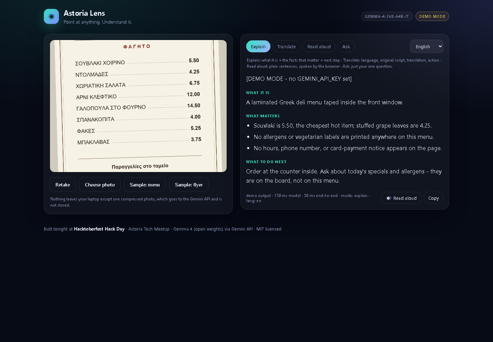

# Astoria Lens

**Point at anything in the neighborhood. Understand it.**

A Gemma 4 vision companion for Astoria's street life: photograph a menu, a flyer taped to a pole, a
storefront sign, a notice, a receipt, a label, or a handwritten note, and get the practical meaning
back in the language you actually read — in a couple of seconds, on your phone-sized screen.

Built at **Hacktoberfest Hack Day — Astoria Tech Meetup × MLH**, October 21, 2026.



*Explain mode on the bundled menu sample. This capture is the labelled demo mode (no API key); with
`GEMINI_API_KEY` set, the same click is a live Gemma 4 call.*

---

## Why this exists

Astoria, Queens is one of the most linguistically diverse places on earth — Greek, Arabic, Bengali,
Spanish, Mandarin, Nepali, Romanian, Bosnian, and a hundred more languages on the same block. The
barrier for a neighbor is rarely "read the letters." It is:

- a Greek deli menu with no English and a counter-only ordering rule,
- a health flyer where the useful sentence is in 9-point fine print,
- a notice with a deadline, a fee, and a phone number,
- a parent or grandparent who can see the paper but can't parse it fast enough.

Translation apps translate *words*. Astoria Lens answers the real question: **what is this, and what
do I do about it?** Four modes, six output languages, one photo.

## Demo in 30 seconds

```bash
cd astoria-lens

# Windows PowerShell
$env:GEMINI_API_KEY="your-key-from-https://aistudio.google.com/apikey"
python tools/check_api.py     # one real call - must pass before you demo
python server.py

# macOS / Linux
export GEMINI_API_KEY="your-key-from-https://aistudio.google.com/apikey"
python3 tools/check_api.py
python3 server.py
```

Open <http://localhost:8000>, click **Sample: menu**, then flip between **Translate / Read aloud /
Explain** and change the answer language. Shortcut for demos and screenshots:
<http://localhost:8000/?sample=menu> auto-loads the photo, no camera permission needed. No pip
install — the server is standard library only, Python 3.9+.

**Verify before you demo:** `python tools/check_api.py` makes one real vision call and prints the
model, HTTP status, latency, and the first line of the answer. `python tools/selftest.py` runs 69
offline checks (mock Gemini endpoint, no key, no network) covering all four modes, the exact request
contract, and the error paths. If `check_api.py` prints **HTTP 402**, that key's project is on
pay-as-you-go/prepay with no balance and cannot call Gemma 4 (free-tier only) — create a key in a new
AI Studio project with billing off, or run without a key in labelled demo mode.

No API key? It still runs. The server falls back to **demo mode** with recorded sample output,
clearly labelled `[DEMO MODE]` and a "demo mode" pill in the UI, so a live demo never dies on a
missing environment variable.

## Modes

| Mode | Question it answers | Output |
| --- | --- | --- |
| **Explain** | What is this and what do I do? | one-line what it is · up to three facts that matter (price, date, deadline, fee, allergen, hours, phone, who to call) · next action |
| **Translate** | What does it say, and what do I do? | detected language · original script exactly · translation into the chosen language · one line on what to do |
| **Read aloud** | Read this to me. | ~60-word plain read-aloud script in the chosen language, no markup — also spoken by the browser |
| **Ask** | Does this contain nuts? Is it open on Sunday? | just the answer to that one question, plus where in the image it is written |

Every mode leads with the answer, stays under about 120 words (Read aloud ~60, Ask ~80), and
surfaces dates, deadlines, fees, allergens, hours, phone numbers, and who to call whenever they
appear — never inventing text it could not read.

Answer language: English, Español, Ελληνικά, العربية, বাংলা, 中文.

## How it works

```
 browser (camera / file / samples)
        │  canvas → ≤1280px JPEG, q0.85
        ▼
 server.py  (stdlib http.server, 127.0.0.1:8000)
        │  POST /api/analyze  {image, mime, mode, lang, question}
        ▼
 Gemini API  →  gemma-4-26b-a4b-it
        │  inlineData (base64 image) + system instruction + mode prompt
        ▼
 plain text  →  light markdown render → screen → SpeechSynthesis
```

- **The API key never reaches the browser.** The page talks only to `server.py`; the server is the
  only thing holding `GEMINI_API_KEY`.
- **The photo is downscaled client-side** to ≤1280 px / JPEG 0.85 before it leaves the laptop —
  faster round trip, smaller payload, and a lot less of someone's mail on the wire.
- **No storage.** One request, one response, nothing written to disk, no analytics.
- **No dependencies.** `server.py` imports only the Python standard library; the front end is three
  static files and no build step. Clone, run, demo.
- **Swappable backend.** `GEMINI_API_BASE` and `GEMMA_MODEL` are environment variables; point them
  at a self-hosted Gemma endpoint (Ollama, vLLM, llama.cpp server) and the same UI runs fully local.
  `tools/selftest.py` already runs the whole app against a local mock of the same endpoint.

### Gemma 4 details

| Setting | Value |
| --- | --- |
| Model | `gemma-4-26b-a4b-it` (default), `gemma-4-31b-it` via `GEMMA_MODEL` |
| Endpoint | `POST https://generativelanguage.googleapis.com/v1beta/models/{model}:generateContent` |
| Image input | `inlineData: {mimeType, data}` — base64, JPEG/PNG/WebP |
| System instruction | sets the neighborhood-copilot persona, practicality rules, and output language |
| Thinking | `thinkingConfig.thinkingLevel = "minimal"` for street-corner latency (override with `GEMMA_THINKING=high`) |
| Generation | `temperature 0.35`, `maxOutputTokens 900` |

Gemma 4 is released under **Apache 2.0 open weights**; this app uses the hosted Gemini API for
tonight's demo but is written so the same call can be served by a local model.

## Repo layout

```
astoria-lens/
├── server.py              # stdlib proxy + prompt engineering + demo mode
├── static/
│   ├── index.html         # one page: camera, modes, result
│   ├── app.js             # capture, downscale, fetch, markdown-lite, speech, ?sample= deep link
│   ├── style.css
│   └── samples/           # menu.png, flyer.png (demo-safe inputs), screenshot.png, titlecard.png
├── tools/
│   ├── check_api.py       # one real call: proves the key + model work before you demo
│   ├── selftest.py        # 69 offline checks against the mock Gemini endpoint
│   ├── mock_gemini.py     # the mock backend selftest uses
│   ├── make_samples.py    # regenerates the sample photos
│   └── make_title_card.py # 1280x720 title card for the demo video
├── skills.md              # agent-skill definition (framework-agnostic)
├── SUBMISSION.md          # pitch, demo script, judge Q&A, tonight's run sheet
├── LICENSE                # MIT
└── .env.example
```

## Hack it in the next hour

Everything is deliberately shallow:

1. **Make it yours** — change `SYSTEM` in `server.py`. Different neighborhood, different rules:
   a hospital wayfinding skill, a tenant-rights letter reader, a night-shift safety sign reader.
2. **Add a mode** — one entry in `MODE_INSTRUCTIONS` and one chip in `static/index.html`.
3. **Add a language** — one line in `LANGUAGES` (server) and one `<option>` (client).
4. **Self-host** — set `GEMINI_API_BASE` to your Ollama/vLLM endpoint and `GEMMA_MODEL` to your
   local checkpoint; the app becomes offline-first.
5. **Feed it your own photos** — `static/samples/` is just files; drop in three images from the
   block and the demo is local.

## What's next

- **Offline mode** with a quantized Gemma 4 on-device build (E2B/E4B) for subway-level connectivity.
- **Multi-page capture** — photograph a lease or a benefits letter page by page.
- **Share sheet** — send the result as a text message to a family member.
- **Voice-first** flow for elders: no buttons, just "show me the paper."
- **Community-contributed prompts** for local document types (311 notices, landlord letters,
  school forms) — the real open-source contribution path.

## Honest limits

- Not medical, legal, or immigration advice. It explains what a document says; it is not a
  professional.
- It refuses to guess at unreadable text, and says which part it couldn't read.
- Don't photograph people or documents that aren't yours to share. The image goes to the Gemini API
  under Google's terms, then is forgotten by this app.
- **Gemma 4 on the Gemini API is free tier only:** it cannot be paid past the ceiling, free-tier
  prompts may be used to improve Google's products, rate limits are per Cloud project, and the daily
  quota resets at midnight Pacific (3am ET) — so there is no reset during an evening hackathon.
  Don't feed it anything you wouldn't paste into a public chat, and handle 429s with a retry (the
  server already retries once).

## License

MIT — see [LICENSE](LICENSE). Gemma 4 model weights are Apache 2.0, © Google.
